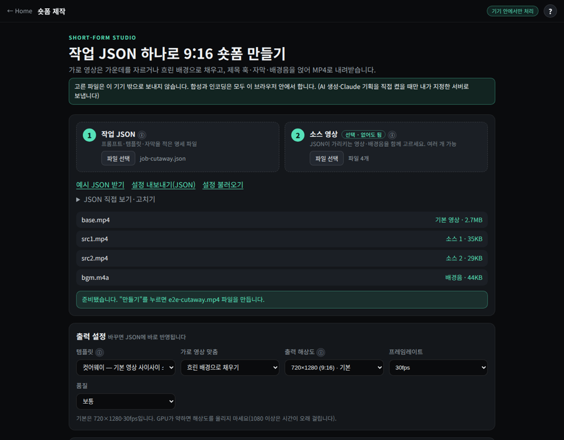
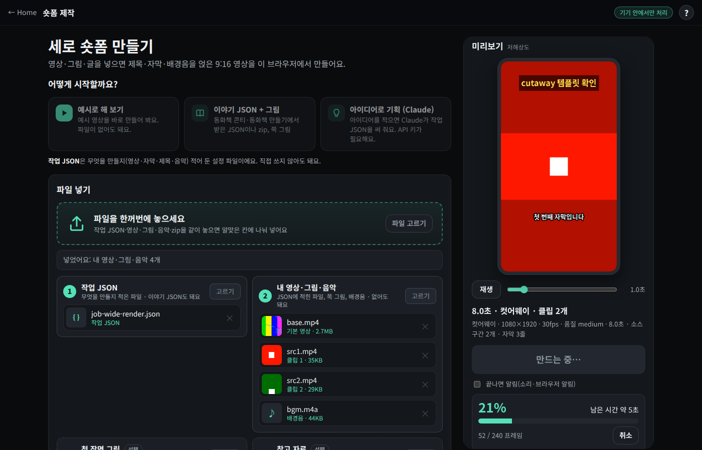
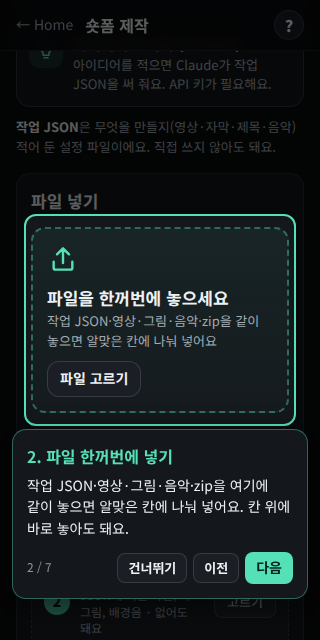

# 숏폼 제작 사용법 (minimax-h3-video/shortform)

파일 두 개 — **프롬프트 JSON(작업 명세)** 와 **소스 영상(없어도 됨)** — 로 9:16 숏폼 MP4 를 만든다.
영상 생성은 내가 띄운 서버(MiniMax-H3 같은 모델을 SGLang·vLLM 으로 서빙, 또는 minimax-h3-video 웹 서버)가 하고,
합성(템플릿·자막·제목·배경음)은 CLI 는 ffmpeg, 웹은 브라우저 안에서 한다.

> 아래 명령은 이 저장소에서 가짜 서버(`tests/fake_servers.py`)로 실제로 돌려 본 것이다.
> 단, 2절의 `sglang serve`·`vllm serve` 는 공식 문서의 명령을 옮긴 것이고 여기서는 GPU 가 없어 실행해 보지 못했다.

---

## 1. 설치

`scripts/setup.sh` 하나로 준비한다. 멱등이라 몇 번 실행해도 되고, 끝에 무엇이 준비됐고 무엇이 빠졌는지 요약표와 다음 명령을 보여 준다.

> **격리 원칙: 설치 위치는 레포 안의 `.venv/`·`.tools/` 뿐이고, 기존 환경을 건드리지 않는다.**
> 시스템 파이썬·전역 pip/npm·`~/.local`·apt/brew·sudo·셸 rc 파일·다른 venv(minimax-h3-video 의 venv 포함)는 손대지 않는다.
> pip·uv·npm 캐시도 `.tools/cache`·`.tools/npm-cache` 로 가둔다. PATH 는 `source scripts/env.sh` 를 한 그 셸에서만 바뀌고 `shorts-env-off`(또는 `deactivate`)로 되돌린다.
> 이미 조건을 만족하는 도구는 그대로 쓰고, 없을 때만 `.tools/` 에 받는다(받기 전에 무엇을·어디서·어디로 받을지 보여 주고 묻는다. `--yes` 면 묻지 않음).
> 지우기: `scripts/setup.sh --uninstall` (`.venv/`·`.tools/` 만, 경로를 보여 주고 확인).

| 필요한 것 | 있으면 | 없으면 `.tools/` 에 받는 것 (검증) |
|---|---|---|
| Python ≥3.10 | 그 파이썬으로 `.venv` 생성 | uv 단일 바이너리(`.tools/bin`, sha256) → 독립 파이썬 3.12(`.tools/python`) |
| ffmpeg·ffprobe (drawtext 필터 포함) | 그대로 씀 | ffmpeg.org 다운로드 페이지가 안내하는 정적 빌드 — Linux x86_64·arm64: BtbN GitHub 릴리스(최신 릴리스 분기 gpl, sha256, 약 150MB), macOS: evermeet.cx(크기 확인, arm64 는 Rosetta) → 안 돌면 martin-riedl arm64(sha256). johnvansickle 빌드는 drawtext 가 빠져 있어 쓰지 않음 |
| 한글 글꼴 | `fc-match`·`fc-list :lang=ko` 로 찾음 | Noto Sans KR Bold(SIL OFL, sha256 고정) → `.tools/fonts`, env.sh 가 `SHORTS_FONT` 로 잡음 |
| Node(웹 개발만, `package.json` engines `^20.19.0 \|\| >=22.12.0`) | 그대로 씀 | nodejs.org 공식 22.x tarball(SHASUMS256) → `.tools/node` |

`--isolated` 를 주면 시스템에 있어도 위 로컬 사본을 강제로 쓴다(파이썬·ffmpeg·글꼴·node). `--offline` 은 아무것도 받지 않고 확인만 한다.
CLI 는 env.sh 를 켜지 않아도 `.tools/bin` 의 ffmpeg 와 `.tools/fonts` 의 글꼴을 먼저 찾는다.

### 1-1. 로컬 PC (CLI)

```bash
git clone https://github.com/33modeling/minimax-h3-video.git && cd minimax-h3-video/shortform
scripts/setup.sh                 # = --mode cli: .venv + pip install -e . + ffmpeg/drawtext + 한글 글꼴
source scripts/env.sh            # 이 셸에서만 .venv·.tools 켜기 (+ .env 로드)
shorts doctor                    # ✓/✗/△ 점검, 필수 항목 실패면 종료 코드 1 (--json 도 됨)
```

- 키·서버 주소는 `.env` 에 둔다(`.env.example` 을 복사, setup 이 없을 때 자동 복사). `.env` 는 `.gitignore` 에 있다.
- 설치 없이도 `./bin/shorts --help` 로 바로 실행할 수 있다(표준 라이브러리만 씀).
- 옵션: `--python /경로/python3.12`, `--venv 경로`(env.sh 에는 `export SHORTS_VENV=경로`), `--index-url URL`(사내 PyPI 미러, `PIP_INDEX_URL` 도 존중), `--yes`.
- `make setup` · `make doctor` · `make test` · `make build` 로도 된다(`make setup ARGS=--yes`).

### 1-2. 클러스터 (minimax-h3-video 레포 안에서)

shorts 는 **자기 `.venv` 를 쓰고 H3 의 venv 는 건드리지 않는다.** 요청 본문은 기본으로 내장 호환 클라이언트(h3video `client.VideoRequest` 와 같은 형식)가 만든다.

```bash
# shortform/ 은 minimax-h3-video 레포 안에 있어서 상위 폴더를 자동으로 H3 레포로 쓴다. 다른 곳이면 --h3-repo 경로 또는 H3_REPO
# (레포 루트에서 pip install -e . 했거나 source scripts/cluster_env.sh 했다면 `h3video shorts ...` 로 바로 써도 된다)
scripts/setup.sh --mode cluster --yes                   # cli 준비 + h3 레포 확인, .env 에 H3_REPO 기록(새 .env 일 때)
scripts/setup.sh --mode cluster --with-h3video --yes    # (선택) h3video 소스를 .venv 에 pip install -e --no-deps (sglang 은 안 받음)
source scripts/env.sh            # H3_REPO 가 있으면 cluster_env.sh 를 서브셸에서 읽어 H3_ENDPOINT·H3_REF_ENDPOINT·H3_INBOX_DIR 만 가져옴
shorts doctor && shorts server check
```

- 서버(SGLang, H100 4장)는 레포 루트에서 `bash scripts/up.sh` 하나로 띄운다(끄기 `bash scripts/down.sh`). 단계별로는 2-1절.
- env.sh 는 cluster_env.sh 를 **읽기만** 한다. HOME·PATH·HF 설정은 가져오지 않으므로 지금 셸이 바뀌지 않는다. 우선순위: 셸에 이미 있는 값 > `.env` > cluster_env.sh 기본값.
- `H3_INBOX_DIR` 이 있으면 `SHORTS_INBOX` 기본값이 된다(`--inbox-dir` 생략 가능).

### 1-3. 웹 개발

```bash
scripts/setup.sh --mode web              # node 확인(낮거나 없으면 .tools/node) + npm ci (캐시 .tools/npm-cache)
scripts/setup.sh --mode web --build      # + vite build 확인
source scripts/env.sh && npm run dev
```

`--mode all` 은 cli + web + cluster 를 한 번에 한다.

---

## 2. 서버 준비

CLI 는 서버 주소만 있으면 종류(SGLang / vLLM / h3video)를 스스로 알아낸다. 헷갈리면 `--backend` 로 지정한다.

### 2-1. 클러스터에서 H3 띄우고 바로 쓰기 (minimax-h3-video + SGLang, H100 4장)

레포 루트(minimax-h3-video, 33modeling/minimax-h3-video)의 스크립트를 그대로 쓴다. 한 번에 하려면 `bash scripts/up.sh`. GPU 가 없는 이 환경에서는 실행해 보지 못했다.

```bash
# 0) 내 PC: 코드 올리기 (클러스터는 GitHub egress 없음)
CLUSTER_SSH=user@host CLUSTER_CODE_DIR=/user-volume/<me>/minimax-h3-video bash scripts/sync_to_cluster.sh
# shortform/ 은 같은 레포라 위 동기화에 같이 올라간다

# 1) 클러스터: venv + sglang[diffusion] + 가중치 확인
cd /user-volume/<me>/minimax-h3-video && source scripts/cluster_env.sh
bash scripts/provision.sh

# 2) tmux 에서 서버 두 개 (포그라운드)
bash scripts/serve.sh fl2va  --gpus 0,1,2,3      # 텍스트·첫 프레임 → 영상, 포트 30010
bash scripts/serve.sh ref2va --gpus 4,5,6,7      # 소스 영상·이미지 참조 → 영상, 포트 30011
#   serve.sh 가 실행하는 명령: sglang serve --model-path "$H3_MODEL_DIR" --model-variant fl2va \
#     --num-gpus 4 --ulysses-degree 4 --performance-mode speed --host 0.0.0.0 --port 30010

# 3) 다른 창: 상태 확인
bash scripts/health.sh

# 4) 환경변수(H3_ENDPOINT=…:30010, H3_REF_ENDPOINT=…:30011, H3_INBOX_DIR) 잡고 실행
source scripts/cluster_env.sh
/user-volume/<me>/minimax-h3-video/shortform/bin/shorts run prompt.json [source.mp4] --inbox-dir "$H3_INBOX_DIR"
```

- CLI 는 `--server` 가 없으면 `SHORTS_SERVER` → `H3_ENDPOINT` 를, `--ref-server` 가 없으면 `SHORTS_REF_SERVER` → `H3_REF_ENDPOINT` 를 쓴다.
  **소스 영상·참조 이미지가 없는 장면은 fl2va(30010), 있는 장면은 ref2va(30011)** 로 자동으로 보낸다(가짜 서버 두 개로 시험함).
- 같은 venv 에 minimax-h3-video 가 `pip install -e .` 돼 있으면 그 `h3video.client.VideoRequest` 로 요청 본문을 만든다(없으면 같은 형식의 내장 구현).
- 소스 영상은 기본으로 `file://` 경로로 넘기고 서버가 그 경로를 읽으므로 `--inbox-dir "$H3_INBOX_DIR"`(group-volume)로 복사해 넘긴다.
  공유 폴더가 없으면(SSH 터널 등) `--inline` 으로 `data:…;base64` URI 를 요청에 넣어 보낸다. SGLang MiniMax-H3 는
  `conditions[].uri` 로 `file://`(서버 로컬)·`http(s)://`·`data:;base64`·`base64://` 를 받는다(sglang `minimax_h3/material_io.py`).

**내 PC 에서 SSH 터널로 붙기** — 텍스트만(t2va) 쓰면 바로 된다. 소스 영상을 보내려면 클러스터의 `h3video web`(2-3, 업로드를 inbox 로 옮겨 줌)에 붙는다.

```bash
ssh -N -L 30010:127.0.0.1:30010 -L 30011:127.0.0.1:30011 user@cluster-node &
export H3_ENDPOINT=http://127.0.0.1:30010 H3_REF_ENDPOINT=http://127.0.0.1:30011
./bin/shorts server check
./bin/shorts run prompt.json
```

H3 사양(보내기 전에 CLI 가 한국어로 막는다): 장면 4~15초, 24fps, 짧은 변 768px, 화면비 `9:16 16:9 1:1 4:3 3:4 21:9 auto`,
ref2va 참조 합계 12개 이하(영상 3개·이미지 9개·오디오 3개 이하, 참조 영상 각 2~15초·합계 15초).
**생성 영상은 짧은 변 768 기반(9:16 이면 약 768×1366, 24fps)** 이고, 합성 단계에서 720×1280 또는 1080×1920·30fps 로 맞춘다.
H3 는 장면당 수 분 걸리므로 CLI 는 기본으로 장면당 30분까지 기다린다. 참조 영상의 `start`/`end` 는 그 구간만 잘라 보낸다.

- 요청 형식: `POST /v1/videos` (JSON: task·prompt·conditions·target{short_edge 768, aspect_ratio, duration_seconds}·seed) → `GET /v1/videos/{id}` → `GET /v1/videos/{id}/content`.
  minimax-h3-video 의 `client.py` 와 같은 형식이다.

### 2-2. vLLM(vLLM-Omni) (미실행)

[vLLM-Omni Videos API](https://docs.vllm.ai/projects/vllm-omni/en/latest/serving/videos_api/) 의 `/v1/videos`(multipart: prompt·seconds·size·seed·input_reference)에 붙는다.
참조는 1개만 보낸다(첫 프레임 이미지 또는 첫 소스). 서버 실행 명령은 위 문서의 모델별 예시를 따른다.

### 2-3. minimax-h3-video 로 띄운 서버에 연결

`h3video web` 서버는 파일을 업로드로 받아 inbox 로 옮겨 주므로, 원격 서버여도 소스 영상을 그대로 보낼 수 있다.

```bash
# 클러스터 쪽은 minimax-h3-video/USAGE.md 대로 SGLang(30010/30011) + h3video web(8790)
ssh -N -L 8790:127.0.0.1:8790 user@cluster &          # PC 로 당겨오기
./bin/shorts server check --server http://127.0.0.1:8790
./bin/shorts run prompt.json source.mp4 --server http://127.0.0.1:8790
```

### 2-4. 주소·키 환경변수

| 변수 | 뜻 |
|---|---|
| `SHORTS_SERVER` (없으면 `H3_ENDPOINT`) | 서버 주소 (`--server` 와 같음, fl2va 30010) |
| `SHORTS_REF_SERVER` (없으면 `H3_REF_ENDPOINT`) | 참조 모드 서버 (`--ref-server`, ref2va 30011) |
| `SHORTS_API_KEY` | 서버에 `--api-key` 를 걸었으면 `Authorization: Bearer` 로 붙임 |
| `SHORTS_INBOX` / `SHORTS_INBOX_URI` | 2-1 의 공유 폴더 |
| `ANTHROPIC_API_KEY` | Claude 기획(7절)을 쓸 때만 |
| `SHORTS_RESOLUTION`·`SHORTS_FPS`·`SHORTS_QUALITY` | 출력 기본값(옵션·JSON 에 없을 때만) |

위 값은 `.env` 에 적어 두면 `source scripts/env.sh` 가 읽는다(값은 출력하지 않는다. `shorts doctor` 도 키는 "설정됨"만 표시).

SSH 터널 예: `ssh -N -L 30010:127.0.0.1:30010 -L 30011:127.0.0.1:30011 user@cluster &` 후 `--server http://127.0.0.1:30010`.

연결 확인:

```bash
./bin/shorts server check --server http://127.0.0.1:30010
# 서버: http://127.0.0.1:30010 / 종류: sglang / 모델: MiniMaxAI/MiniMax-H3 / 가능한 모드: t2va, fl2va, ref2va / 사양
```

---

## 3. 프롬프트 JSON 작성법

스키마: [`schema/job.schema.json`](schema/job.schema.json). 경로는 JSON 파일이 있는 폴더 기준이고, 웹에서는 파일 이름으로 맞춘다.

| 필드 | 뜻 | 기본 |
|---|---|---|
| `prompt` | AI 영상 프롬프트(영어 권장). 있으면 AI 로 생성 | — |
| `scenes` | 장면 여러 개 `[{prompt, sources, image, duration, seed}]` (`prompt` 와 같이 못 씀) | — |
| `sources` | 소스 영상 목록. **prompt 가 있으면 AI 참조 입력**, 없으면 합성 재료. `"a.mp4"` 또는 `{"path","start","end"}` | 두 번째 파일 |
| `base` | 기본 영상(템플릿의 주 화면). 생성 영상을 그 위에 얹는다 | — |
| `image` | 첫 프레임 이미지(fl2va) | — |
| `duration` / `ratio` / `seed` | AI 장면 길이 4~15초 / 화면비 / 시드 | 8 / `9:16` / 0 |
| `server` `ref_server` `backend` `model` `poll` `timeout` | 실행 설정(옵션·환경변수로도 줌) | auto, 3초, 장면당 1800초 |
| `template` | `cutaway` `split` `pip` `montage` (base 없으면 montage) | base 있으면 cutaway |
| `fit` | 가로 영상: `crop`(가운데 자르기) / `blur`(흐린 배경 채우기) | blur |
| `resolution` | 출력 해상도 `WxH`. 프리셋 `540x960` `720x1280` `1080x1920` `1440x2560`(9:16) · `1080x1080`(1:1) · `1080x1350`(4:5) · `1920x1080`(16:9), 또는 임의 값(짝수, 짧은 변 240~2160, 긴 변 2560 이하). 9:16 이 아니어도 템플릿이 맞춰 배치(16:9 분할은 좌우) | 720x1280 |
| `gen_size` | AI 생성 크기. 짧은 변 숫자(480·576·720·768) 또는 `WxH`. SGLang H3 는 `target.short_edge`, vLLM 은 `size`(ratio 로 계산)로 보냄. **H3 상한 768**: 넘으면 H3 서버로는 보내기 전에 막음(vLLM 은 그대로). h3video 웹 서버는 768 고정 | H3 768, vLLM 720 |
| `fps` | 출력 프레임레이트 12~60 (생성은 H3 24fps 고정, 합성 때 맞춤) | 30 |
| `quality` | 출력 품질 `low` `medium` `high` (CLI x264 crf 28/23/18, 웹은 픽셀당 비트레이트) | medium |
| `max_duration` | 길이 상한(초) | 60 |
| `title` | 상단 훅 문구 | — |
| `captions` | 자막, 한 줄에 한 장면. 시간 자동 배분(글자 수 비례), `{"text","start","end"}` 로 직접 지정 | — |
| `bgm` `bgm_volume` `original_volume` | 배경음과 볼륨(0~1) | —, 0.25, 1 |
| `output` | 출력 파일 | short.mp4 |

### 3-1. 입력 정리 — 이미지·영상을 어디에 넣나 (CLI·웹 같음)

| 넣는 것 | 뜻 | CLI (`shorts run` = `h3video shorts run`) | 웹(숏폼 제작) | JSON |
|---|---|---|---|---|
| 첫 프레임 이미지 | AI 영상이 이 그림에서 시작 (fl2va) | `--image first.png` | 칸 3 | `image` |
| 참조 이미지 | 인물·물건 생김새 참고 (ref2va, 최대 9) | `--ref face.png` (여러 개) | 칸 4 | `sources` |
| 참조 영상 | 동작·카메라 참고 (최대 3, 2~15초) | `--ref dance.mp4` | 칸 4 | `sources` |
| 참조 오디오 | 목소리·소리 참고 (최대 3) | `--ref voice.mp3` | 칸 4 | `sources` |
| 기본 영상 | 템플릿의 주 화면(내 영상, AI 영상을 그 위에 얹음) | `--base base.mp4` | 칸 2 + JSON `base` | `base` |
| 합성 재료 영상 | AI 없이 이어 붙일 내 클립 | `--source clip.mp4` (여러 개) | 칸 2 | `sources` |
| 배경음 | | JSON `bgm` 또는 두 번째 파일 | 칸 2 | `bgm` |

```bash
h3video shorts run job.json --image first.png                    # 이 그림에서 시작하는 AI 영상 + 자막·음악 합성
h3video shorts run job.json --ref face.png --ref dance.mp4       # 내 얼굴·동작을 참고한 AI 영상
h3video shorts run job.json --base talk.mp4 --source b-roll.mp4  # AI 없이 내 영상 합성 (job.json 에 prompt 없음)
```

- 참조(칸 4·`--ref`)가 있으면 ref2va 로 만든다. 이때 첫 프레임 이미지(칸 3·`--image`)는 참조로 함께 보낸다(ref2va 는 시작 프레임을 고정하지 않는다).
- `--ref` 는 JSON 에 `prompt` 가 있을 때만 쓴다(AI 생성 참조). 내 영상을 그대로 합성 재료로 쓰려면 `--source`.
- 웹에서 칸 3·4 에 파일을 고르면 JSON 의 `image`·`sources` 에 이름이 자동으로 들어간다. 칸 2 는 JSON 에 이미 적힌 이름과 짝을 맞춘다.
- 경로: CLI 옵션은 지금 폴더 기준, JSON 안 경로는 JSON 파일 폴더 기준. 장면이 여러 개(`scenes`)면 장면마다 JSON 의 `image`·`sources` 에 적는다.
- 서버까지: h3video 웹 서버(8790)면 업로드되고, SGLang(30010) 직접이면 `$H3_INBOX_DIR`(클러스터 공유 폴더)로 복사해 넘긴다.

**예시 1 — 프롬프트만** (`examples/prompt-only.json`)

```json
{"prompt": "A tabby cat leaps over a wooden fence at golden hour, slow motion", "duration": 8,
 "title": "고양이의 대점프", "captions": ["노을 지는 골목", "담장 앞에 선 고양이", "점프!"], "output": "cat-jump.mp4"}
```

**예시 2 — 소스 영상 있음** (`examples/with-source.json`, 소스는 두 번째 파일로 → AI 참조 ref2va)

```json
{"prompt": "Use <Video 1> as the motion reference: the same person dances on a neon-lit rooftop", "duration": 6,
 "title": "옥상 위 네온 댄스", "captions": ["원본 동작 그대로", "배경만 네온 옥상으로"], "output": "neon-dance.mp4"}
```

**예시 3 — 템플릿 합성만(AI 없음)** (`examples/compose-only.json`)

```json
{"base": "base.mp4", "sources": ["clip1.mp4", {"path": "clip2.mp4", "start": 1, "end": 4}], "template": "cutaway",
 "resolution": "1080x1920", "fps": 30, "quality": "high", "title": "3초 만에 보는 요약", "captions": ["오늘 할 이야기", {"text": "핵심은 이것", "start": 3, "end": 5.5}],
 "bgm": "music.mp3", "output": "summary.mp4"}
```

여러 장면은 `examples/scenes.json`, 정사각·가로 출력은 `examples/square-feed.json`(`"resolution": "1080x1080"`).
틀린 해상도 예: `resolution: 가로·세로는 짝수여야 합니다 (지금 721x1280)`, `resolution: 짧은 변은 240~2160, 긴 변은 2560 이하여야 합니다 (지금 238x1280)`. 틀리면 한국어로 알려 준다: `duration [AI 장면 길이(초)]: 15 이하여야 합니다 (지금 30)`, `templat: 알 수 없는 항목입니다. 혹시 'template' 인가요?`

**템플릿**: 컷어웨이(기본 영상과 소리가 계속 흐르고 소스가 사이사이 전체 화면, 소스 합은 길이의 60%까지) ·
위아래 분할(위 기본, 아래 소스 반복) · PIP(기본 전체, 소스는 오른쪽 위 작은 창) · 몽타주(소스를 이어 붙이고 기본 영상 소리를 깖, 기본 영상이 없으면 소스 자기 소리).

### 3-2. 이야기 JSON + 쪽 그림으로 한 번에 (장면 수·길이 자동)

숏폼 명세를 쓰지 않고, **동화책 콘티 JSON(허브 `/storybook-conti/`의 "JSON" 내보내기)** 이나 동화책 만들기(storybook-maker)의 `book.json`, 장면 목록 JSON 을 그대로 넣어도 된다. 숏폼 명세로 바꿔서 이어서 만든다.

```bash
h3video shorts run 토토.json pages/                  # 쪽 그림 폴더와 함께 (이름 page-03·03 → 3쪽, cover → 표지, 나머지는 순서대로)
h3video shorts run books/토토-.../book.json          # 동화책 만들기 결과 (그림 경로가 들어 있음)
h3video shorts run 토토.json pages/ music.mp3 --no-narration --dry-run
```

- **장면 수**: 쪽마다 하나. 표지는 표지 그림을 줄 때만.
- **길이**: 장면에 `seconds`(`duration`)가 있으면 그 값. 없으면 쪽 글을 소리 내어 읽는 시간(한국어 공백 뺀 4자/초, 영어 2.5단어/초)에 1.5초를 더한 값이고, 글이 없으면 6초다. 장면 하나는 5~15초이고, 합이 180초를 넘으면 같은 비율로 줄인다. `-s`·`duration` 을 따로 줄 필요가 없다.
- **그림**: 쪽 그림이 그 장면의 첫 프레임(fl2va)이 된다. 그림이 없는 쪽은 그림체와 인물을 글로 넣어 만든다(t2va). 맞는 쪽이 없는 그림은 쓰지 않고 알린다. 이런 그림을 참조로 붙이면 모든 장면이 ref2va 로 바뀌므로 붙이지 않는다.
- **자막·제목**: 쪽 글은 그 장면 시간에 맞춘 자막이 된다(줄마다, 120자 넘으면 문장마다). 제목은 책 제목이다. 템플릿은 몽타주, 가로 그림은 흐린 배경으로 채운다(`fit: blur`). 화면비는 콘티 판형이다.
- **내레이션**: 쪽 글을 H3 가 화면 밖 내레이터 목소리로 읽게 한다(`<d>[Korean] …</d>`). `--no-narration` 이면 빼고 자막만 남는다.
- 웹: 칸 1 에 이야기 JSON 을, 칸 2 에 쪽 그림 여러 장을 고르면 같은 규칙으로 명세를 만들어 넣는다. 메시지 맨 위에 "장면 N개 · 합계 S초 · 그림 K장 연결"이 나오고, 만든 명세는 "JSON 직접 보기·고치기"에서 고칠 수 있다.
- 같은 JSON 을 영상 하나로 이어 붙이기만 하려면(자막·9:16 합성 없이) `h3video json` ([VIDEO.md](../VIDEO.md)).

규칙은 파이썬(`shorts/story.py` + `h3video/story.py`)과 웹(`src/core/story.js`)이 같고, `tests/fixtures/story/` 의 기대 결과로 둘을 같이 확인한다. 규칙을 바꾸면 `python3 tests/fixtures/story/make_expected.py` 로 기대 결과를 다시 만들고 바뀐 부분을 확인한 뒤 커밋한다.

---

## 4. CLI

```bash
./bin/shorts run prompt.json                      # 프롬프트만: AI 생성 → 9:16 합성
./bin/shorts run prompt.json source.mp4           # 소스 영상 있음 (JSON 의 sources 대신)
./bin/shorts run prompt.json base.mp4 a.mp4 b.mp4 # 이름이 JSON 의 base 와 같으면 그 자리, 나머지 영상은 sources
./bin/shorts run prompt.json base.mp4 music.mp3   # 음악 파일은 bgm 이 비어 있으면 배경음 (웹 파일 칸 2와 같은 규칙)
./bin/shorts run prompt.json --dry-run            # 보낼 요청 본문과 ffmpeg 명령만 보기
./bin/shorts run prompt.json --json               # 진행 상황을 줄마다 JSON 이벤트로
./bin/shorts run prompt.json --resolution 1080x1080 --fps 24 --quality high --gen-size 576   # JSON 값보다 우선
./bin/shorts doctor [--json] [--server URL]       # 실행 환경 점검(도구 출처: 시스템/.tools/.venv), 필수 실패면 종료 코드 1
```

진행 표시 형식(가짜 서버 출력과 같은 모양, 시간·ID 는 예시):

```
[1/5 검증] prompt.json + 소스 1개
[2/5 서버 연결] http://127.0.0.1:30010 (참조 모드: http://127.0.0.1:30011)
  서버 종류: sglang · 주소: http://127.0.0.1:30010 · 참조 모드(ref2va): http://127.0.0.1:30011
[3/5 생성] 장면 2개 · 장면당 최대 30:00 대기
  장면 1/2: t2va 요청함 · 작업 ID: video_0001
  장면 1/2  생성 중  [#############-------]  66.7%  경과 3:12  남은 약 1:36  (video_0001)
  장면 2/2  대기열   ⠹ 경과 3:12  (video_0002)
[4/5 다운로드] 장면 2개
[5/5 합성] 컷어웨이 · 720×1280 · 30fps · 품질 medium · 8.0초 · 소스 구간 2개 · 자막 3줄
── 요약 ──
총 소요 9:41 (생성 9:02 · 다운로드 0:03 · 합성 0:31)
  장면 1  t2va   생성 4:48  (video_0001)
출력: /data/short.mp4  720×1280 · 8.0초 · 30fps · 오디오 있음
```

- 터미널이면 장면 줄을 제자리에서 갱신한다. 서버가 progress 를 주면 막대·%·예상 남은 시간, 안 주면 스피너와 경과 시간만 나온다.
- 파이프·로그 파일로 보내면 애니메이션 없이 상태가 바뀔 때와 15초마다 한 줄씩 남긴다(`SHORTS_LOG_INTERVAL=30` 으로 조정).
- `--json` 이면 `stage`·`scene`(state·progress·elapsed·eta·job_id)·`summary` 이벤트가 줄마다 JSON 으로 나온다.
- 연결이 끊기면 `재시도 중(3/5)` 을 보여 주며 5번까지 다시 묻는다(요청 자체는 중복을 막으려고 다시 보내지 않는다).
- 생성이 실패하면 서버 오류에 한국어 설명을 붙인다. 예: `오류: 장면 1 생성 실패: CUDA out of memory …` /
  `설명: GPU 메모리가 부족합니다. 장면 길이(duration)나 gen_size 를 줄이거나…` / `다시 시도: shorts resume video_0001` (실패한 장면만 다시 요청).

- H3 는 H100 4장에서도 장면당 수 분 걸린다. 기본은 3초마다 확인, 장면당 30분(1800초)까지 기다린다(`--poll 5 --timeout 3600` 으로 조정). 진행률 옆에 경과 시간이 나온다. **Ctrl+C** 를 누르면 작업 ID 를 찍고 끝나며 서버 작업은 계속 돈다.
  `./bin/shorts resume video_0001` 로 이어 받아 합성까지 한다. 대기 시간을 넘겨도 같은 안내가 나온다.
- 같은 JSON 을 다시 돌리면 요청이 같은 장면은 받은 파일을 다시 쓴다(새로 만들려면 `--fresh`).
- 받은 영상 길이가 요청과 다르면 `주의:` 로 알리고 받은 길이로 합성한다.
- 보내기 전 H3 한도 검사: 장면 4~15초, 화면비, 참조 영상 3개·각 2~15초·합계 15초 이하.

하위 명령:

```bash
./bin/shorts gen --server http://127.0.0.1:30010 --prompt "a cat jumps" --duration 4 -o clip.mp4
./bin/shorts compose --base base.mp4 --source a.mp4 b.mp4 --template split --captions captions.txt --title "제목" --bgm m.m4a -o short.mp4
./bin/shorts server check --server http://127.0.0.1:30010 [--json]
./bin/shorts resume <작업ID 또는 state.json>
```

---

## 5. 웹

허브 33 Arcade(https://33modeling.pages.dev/shorts/, 비밀번호 게이트)의 **생활 · 생산성 도구 → 숏폼 제작** 카드.
로컬에서는 `npm install && npm run dev` 후 http://localhost:4251/ (빌드는 `npm run build`, 결과는 `dist/`).
처음 열면 7단계 **둘러보기**가 뜨고, 오른쪽 위 **?** 로 언제든 다시 보거나 도움말(예시 JSON 3개·자주 겪는 문제)을 연다.



1. **파일 칸 1 — 작업 JSON**: 3절 형식의 명세. "예시 JSON 받기", "설정 불러오기", "JSON 직접 보기·고치기"(입력하면 0.4초 뒤 다시 검사)도 같은 칸을 채운다.
   틀리면 아래에 한국어 오류가 바로 나온다(문법 오류 줄, 스키마 위반, 오타면 `혹시 'title' 인가요?`).
2. **파일 칸 2 — 소스 영상(선택 · 없어도 됨)**: 여러 개 고를 수 있다. JSON 의 `base`·`sources`·`bgm` 과 **파일 이름**으로 맞추고(폴더는 무시),
   이름이 안 맞는 영상은 `sources` 뒤에, 음악은 `bgm` 이 비어 있을 때 배경음으로 쓴다. 목록에 파일마다 역할(기본 영상·소스 n·배경음·쓰지 않음)이 붙고, 빠진 파일은 빨갛게 표시된다.
3. **출력 설정**: 템플릿(자동·컷어웨이·위아래 분할·PIP·몽타주), 가로 영상 맞춤(흐린 배경/가운데 잘라 채우기), 출력 해상도(프리셋 7종 + 직접 입력 `WxH`),
   프레임레이트(24/25/30/60), 품질(낮음/보통/높음 → 비트레이트). 바꾸면 **JSON 에 바로 써 넣는다**. 기본은 720×1280·30fps(약한 GPU 기준).
4. **AI 생성 연결**(JSON 에 `prompt`·`scenes` 가 있을 때): 기본은 **h3video 웹 서버** 주소 하나(`http://localhost:8790`). 고급으로 **SGLang 직접**을 고르면
   fl2va 주소(기본 `:30010`, 소스 없을 때)와 ref2va 주소(기본 `:30011`, 소스 영상을 참조로 보낼 때)를 따로 넣는다. 생성 크기(짧은 변, 768 상한)도 여기서 고른다.
   "연결 확인"으로 `/api/spec`·`/api/health`(h3video) 또는 `/v1/models`(SGLang)를 불러 본다. 서버는 이 페이지 주소를 CORS 로 허용해야 한다:
   `h3video web --cors-origin https://33modeling.pages.dev`. 원격 GPU 는 `ssh -L 8790:localhost:8790 사용자@서버` 터널로 붙인다
   (https 페이지는 다른 PC 의 http 주소를 혼합 콘텐츠로 막고 localhost 만 허용). SGLang 직접 연결은 참조 파일을 `data:…;base64` URI 로 보낸다(SGLang MiniMax-H3 가 받는 형식, CLI 의 `--inline` 과 같음).
5. **Claude로 기획하기**(선택): 아이디어와 Anthropic API 키(그 브라우저 localStorage 에만 저장, "키 지우기")를 넣고 요청하면 `claude-opus-5-5` 가
   구조화 출력(`output_config.format`, CLI 와 같은 요청)으로 명세 JSON 을 써서 파일 칸 1을 채운다. 파일 칸 2의 영상이 있으면 프레임 몇 장을 함께 보낸다. 검증에 실패하면 오류를 붙여 한 번 다시 묻는다.
6. **미리보기·만들기**: 저해상도(270px) 미리보기를 시간 막대로 넘겨 보거나 소리와 함께 재생한다. **만들기**를 누르면
   단계 줄(검증 → 서버 연결 → 대기열 → 생성 중 → 다운로드 → 합성 → 인코딩 → 완료)과 AI 장면 카드(상태·진행률 막대·경과·남은 시간·작업 ID 복사·재시도 표시)가 나온다.
   진행률은 탭 제목(`⏳ 42% 생성 중`)에도 나오고, "끝나면 알림"을 켜면 소리·브라우저 알림을 준다. **취소**는 언제든 되며 SGLang 은 서버 작업 삭제도 요청한다
   (h3video 웹 서버는 취소 API 가 없어 서버에서는 끝까지 돈다). 실패하면 서버 메시지에 한국어 설명과 **다시 시도** 버튼이 붙는다. 이미 받은 AI 장면은 다시 만들 때 재사용한다.
7. **결과**: 끝나면 자동으로 내려받고(`output` 이름), 아래 플레이어와 "내려받기" 링크가 남는다. 형식은 MP4(H.264 + AAC, WebCodecs + mediabunny).
   리눅스 크롬처럼 AAC 인코더가 없으면 내장 WASM AAC 인코더를 쓰고, H.264 인코더가 없으면 WebM(VP9 + Opus), WebCodecs 자체가 없으면
   MediaRecorder 실시간 녹화(WebM, 영상 길이만큼 걸림)로 바꾸며 화면에 그 사실을 적는다.
8. 고른 파일은 이 기기 밖으로 보내지 않는다(내가 지정한 AI 서버·Anthropic API 로 보내는 경우만 예외). 같은 JSON 이면 CLI 와 같은 배치가 나온다(`src/core/plan.js` 공용).
9. **설정 내보내기(JSON)**: 지금 화면 설정(연결 주소 포함)을 담은 작업 JSON 을 받는다. "설정 불러오기"나 파일 칸 1로 다시 넣으면 화면이 그대로 돌아온다.

 

---

## 6. 결과물

- 위치: JSON 의 `output`(JSON 폴더 기준) 또는 `-o`. AI 장면은 `<출력>.parts/scene01.mp4…` 에 남고 `state.json` 이 이어 받기 정보다.
- 규격: `resolution`(기본 720×1280, 9:16·1:1·4:5·16:9·임의 WxH), `fps`(기본 30), `quality`(기본 medium), H.264 + AAC 48kHz 스테레오, `+faststart`.
- 생성 영상(H3)은 짧은 변 `gen_size`(기본·상한 768), 24fps 이고 합성 단계에서 출력 해상도·fps 로 맞춘다.
- 길이: 템플릿이 몽타주면 소스 길이 합, 그 밖에는 기본 영상 길이. 둘 다 `max_duration`(기본 60초)에서 자른다.

---

## 7. Claude 로 기획하기 (선택)

아이디어 한두 줄(+소스 영상)을 주면 Claude(기본 `claude-opus-5-5`)가 작업 명세 JSON 을 쓴다. 영상은 여전히 내 서버가 만든다.

```bash
export ANTHROPIC_API_KEY=...
./bin/shorts plan "비 오는 밤 네온 거리 감성 숏폼" -o prompt.json
./bin/shorts plan "이 영상 요약 숏폼" --source talk.mp4 -o prompt.json   # 프레임 몇 장(작은 JPEG)을 함께 보냄
./bin/shorts run --idea "비 오는 밤 네온 거리" source.mp4 --plan-output prompt.json   # 기획 → 생성 → 합성 한 번에
./bin/shorts plan "..." --dry-run                                        # 보낼 요청 요약만 (키는 출력 안 함)
```

- Messages API 를 구조화 출력(`output_config.format` json_schema)으로 불러 JSON 만 받고, 받은 JSON 을 전체 스키마로 다시 검사한다(웹도 같은 요청).
  Opus 5.5 는 `tool_choice` 강제(`any`/`tool`)를 400 으로 거절하므로 도구 호출 방식은 쓰지 않는다.
  실패하면 오류를 붙여 1번만 다시 요청한다. 서버 쪽 거절 대비로 `fallbacks: "default"` 를 켠다.
- 모델 바꾸기: `--claude-model`. 웹은 키를 그 브라우저 localStorage 에만 저장한다(지우기 버튼).

---

## 8. 문제 해결

| 증상 | 해결 |
|---|---|
| `서버에 연결하지 못했습니다` | 주소·포트 확인, SSH 터널이 살아 있는지 `./bin/shorts server check` |
| `인증 실패(HTTP 401)` | 서버에 `--api-key` 를 걸었으면 `export SHORTS_API_KEY=...` |
| 참조 파일을 서버가 못 읽음 | SGLang 은 `file://` 를 서버가 읽는다. 공유 폴더 `--inbox-dir`(+`--inbox-uri`), `--inline`(data: URI 로 본문에 넣음) 또는 h3video 웹 서버(업로드 지원) |
| 웹에서 CORS 오류 | 서버가 허브 출처를 허용해야 한다. h3video: `h3video web --cors-origin https://33modeling.pages.dev` |
| 웹에서 혼합 콘텐츠 차단 | https 페이지는 `http://localhost`·`127.0.0.1` 만 허용된다. SSH 터널로 localhost 에 붙이거나 cloudflared·Tailscale https 터널 주소를 쓴다. 브라우저가 "로컬 네트워크 접근"을 물으면 허용 |
| 웹에서 WebCodecs 없음 | 최신 Chrome·Edge 권장. 없으면 실시간 녹화(WebM)로 대신 내보낸다 |
| `ffmpeg 가 없습니다` | `scripts/setup.sh` (레포 안 `.tools/bin` 에 정적 빌드). 시스템에 깔려면 `sudo apt install ffmpeg` / `brew install ffmpeg` |
| ffmpeg 에 drawtext 가 없음(자막·제목 오류, doctor `✗ drawtext`) | 배포판 ffmpeg 가 freetype 없이 빌드된 경우. `scripts/setup.sh --isolated` 로 drawtext 포함 정적 빌드를 `.tools/bin` 에 받고 `source scripts/env.sh` |
| 다른 파이썬이 잡힘(3.10 미만, 엉뚱한 venv) | `shorts doctor` 의 python 줄로 확인 → `source scripts/env.sh`. 그래도면 `scripts/setup.sh --python /경로/python3.12` 또는 `--isolated`(레포 안 독립 파이썬). `.venv` 를 새로: `scripts/setup.sh --uninstall` 후 다시 |
| pip 설치 실패(사내망·미러) | `scripts/setup.sh --index-url https://미러/simple` 또는 `export PIP_INDEX_URL=...`. 다운로드가 막혔으면 `--offline` 으로 무엇이 빠졌는지만 확인 |
| 한글 자막이 네모로 나옴 | `scripts/setup.sh` 가 Noto Sans KR 을 `.tools/fonts` 에 받음. 또는 `export SHORTS_FONT=/usr/share/fonts/opentype/noto/NotoSansCJK-Bold.ttc` |
| 결과가 요청보다 짧음 | 서버가 돌려준 길이를 따른다(`주의:` 줄 확인). 템플릿이 몽타주가 아니면 기본 영상 길이가 상한 |

## 9. 테스트

```bash
tests/fixtures/make_media.sh .tmp/media                    # 시험용 영상(ffmpeg)
python3 -m unittest discover -s tests -p 'test_*.py'       # CLI: 가짜 서버로 gen·compose·run·resume·plan·doctor  (= make test)
node --test tests/unit/                                    # 공용 계획 모듈 + 파이썬과 같은 배치인지
python3 tests/fake_servers.py video 30010 sglang           # 손으로 시험할 가짜 SGLang 서버
```
